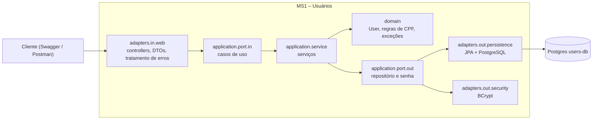
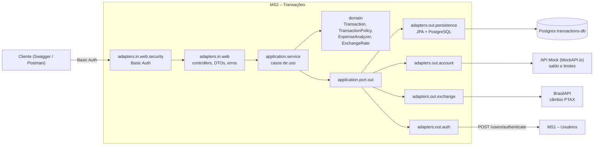

# Desafio Beca Java 2026

Sistema de gestão de finanças pessoais, desenvolvido para o Desafio Beca Java 2026. Aplica Java, APIs REST, persistência de dados, arquitetura hexagonal e microsserviços.

**Status:** MS1 (usuários) e MS2 (transações) prontos para a demonstração de 13/11/2026.

## Sumário

- [Arquitetura](#arquitetura)
- [Tecnologias](#tecnologias)
- [Estrutura do repositório](#estrutura-do-repositório)
- [Como subir o ambiente](#como-subir-o-ambiente)
- [Variáveis de ambiente](#variáveis-de-ambiente)
- [MS1 – Usuários](#ms1--usuários)
- [Importação de usuários por CSV](#importação-de-usuários-por-csv)
- [MS2 – Transações](#ms2--transações)
- [Decisões de projeto](#decisões-de-projeto)
- [Roteiro de demonstração](#roteiro-de-demonstração)
- [Testes e cobertura](#testes-e-cobertura)
- [Respostas e erros HTTP](#respostas-e-erros-http)

## Arquitetura

O sistema é composto por microsserviços independentes, cada um com seu próprio banco PostgreSQL:

| Serviço | Responsabilidade | Situação |
|---|---|---|
| **MS1 – Usuários** | Cadastro, consulta, atualização, exclusão e importação de usuários por CSV | Pronto |
| **MS2 – Transações** | Depósitos, retiradas, transferências e compras; saldo e limites (API Mock); câmbio (BrasilAPI); análise de despesas; relatório CSV; autenticação básica validada no MS1 | Pronto |

Os dois serviços seguem a **arquitetura hexagonal**: o domínio e os casos de uso não dependem de framework web nem de banco; quem fala com o mundo externo são os adaptadores, ligados por portas (interfaces).



O MS2 tem a mesma organização e conversa com três serviços externos, cada um por uma porta de saída:



Pacotes do MS1 (`users/src/main/java/br/com/beca/users`):

```
adapters/
  in/web/            UserController, UserAuthController, DTOs, UserWebMapper, GlobalExceptionHandler, OpenApiConfig
  in/web/csv/        UserCsvController (upload do CSV)
  out/persistence/   UserPersistenceAdapter, entidade JPA, mapper, repositório
  out/security/      BCryptPasswordAdapter
application/
  port/in/           casos de uso (Create, List, FindById, Update, Delete, ImportUsersCsv, Authenticate)
  port/out/          UserRepositoryPort, PasswordEncoderPort
  service/           implementação dos casos de uso
domain/
  model/             User
  validation/        CpfValidator
  exception/         UserNotFoundException, UserAlreadyExistsException, InvalidCsvException, InvalidCredentialsException
validation/          anotação @ValidCpf (Bean Validation)
```

Pacotes do MS2 (`transactions/src/main/java/br/com/beca/transactions`):

```
adapters/
  in/web/            TransactionController, ReportController, DTOs, GlobalExceptionHandler, OpenApiConfig
  in/web/security/   SecurityConfig, UsersServiceAuthenticationProvider, respostas 401/403 em JSON
  out/persistence/   TransactionPersistenceAdapter, entidade JPA, mapper, repositório
  out/account/       MockApiAccountAdapter (saldo e limites no MockAPI)
  out/exchange/      BrasilApiExchangeRateAdapter (câmbio)
  out/auth/          UsersServiceAuthAdapter (valida e-mail e senha no MS1)
application/
  port/in/           casos de uso (criar, consultar, listar, saldo, análise de despesas, relatório CSV)
  port/out/          TransactionRepositoryPort, AccountLimitsPort, ExchangeRatePort, UserAuthenticationPort
  service/           implementação dos casos de uso
domain/
  model/             Transaction, TransactionRequest, TransactionPolicy, ExpenseAnalyzer, ExchangeRate, ...
  exception/         exceções de negócio
```

O pacote `domain` não importa nada de Spring, JPA ou HTTP.

## Tecnologias

Java 25, Maven, Spring Boot 4, Spring Data JPA, PostgreSQL 16, Bean Validation, Spring Security Crypto (BCrypt), Apache Commons CSV, Springdoc OpenAPI (Swagger), JUnit 5, Mockito, JaCoCo, Docker e Docker Compose, Git e GitHub.

## Estrutura do repositório

Monorepo, com um diretório por microsserviço:

```
desafio-beca-java-2026/
├── users/                 MS1 – Usuários
│   ├── src/
│   ├── exemplos/          CSV de exemplo para importação
│   ├── Dockerfile
│   └── pom.xml
├── transactions/          MS2 – Transações
│   ├── src/
│   ├── exemplos/          exemplo de conta para o MockAPI
│   ├── Dockerfile
│   └── pom.xml
├── scripts/
│   └── dados-demo.sh      carrega dados de exemplo para a demonstração (opcional)
├── docker-compose.yml
├── .env.example
├── users-api.http         requisições de exemplo do MS1 (IntelliJ HTTP Client)
├── transactions-api.http  requisições de exemplo do MS2
└── README.md
```

## Como subir o ambiente

**Pré-requisitos:** Java 25, Docker com Docker Compose (por exemplo, Rancher Desktop) e Git.

```bash
git clone https://github.com/gabsbackess/desafio-beca-java-2026.git
cd desafio-beca-java-2026
cp .env.example .env        # no Prompt de Comando: copy .env.example .env
```

Edite o `.env`: troque `seu_usuario` e `sua_senha` por valores locais e coloque a URL do seu projeto no MockAPI em `MOCKAPI_URL` (veja [Como configurar a API Mock](#como-configurar-a-api-mock)).

> O `.env` contém credenciais locais. **Nunca** o envie ao GitHub (ele já está no `.gitignore`). O `.env.example` traz só os nomes das variáveis.

Suba tudo com um comando, na raiz do repositório:

```bash
docker compose up -d --build
```

O Compose sobe os dois bancos, o MS1 e o MS2. Cada serviço só inicia depois que o seu banco está saudável (`healthcheck`), e o MS2 espera o MS1 iniciar. O MS2 fala com o MS1 pelo nome do serviço na rede do Compose (`http://users:8081`), nunca por `localhost`. Outros comandos úteis:

```bash
docker compose ps                  # situação dos containers
docker compose logs -f users       # logs do MS1
docker compose logs -f transactions # logs do MS2
docker compose down                # parar (os dados ficam nos volumes)
docker compose down -v             # parar e apagar os dados
```

| Serviço | Porta local |
|---|---|
| MS1 – Usuários | 8081 |
| MS2 – Transações | 8082 |
| PostgreSQL – users-db | 5433 |
| PostgreSQL – transactions-db | 5434 |

## Variáveis de ambiente

Definidas no `.env` (modelo em `.env.example`):

| Variável | Para que serve |
|---|---|
| `USER_DB_NAME` | Nome do banco do MS1 |
| `USER_DB_USER` | Usuário do banco do MS1 |
| `USER_DB_PASSWORD` | Senha do banco do MS1 |
| `TRANSACTIONS_DB_NAME` | Nome do banco do MS2 |
| `TRANSACTIONS_DB_USER` | Usuário do banco do MS2 |
| `TRANSACTIONS_DB_PASSWORD` | Senha do banco do MS2 |
| `MOCKAPI_URL` | URL base do projeto no MockAPI, sem barra no final (por exemplo `https://xxxx.mockapi.io/api/v1`) |

Dentro do Compose, cada serviço recebe a URL, o usuário e a senha do banco por variáveis `SPRING_DATASOURCE_*`, e o MS2 recebe também `MOCKAPI_URL` e `USERS_URL`. Rodando fora do Docker (IDE ou `./mvnw`), o `application.properties` usa `localhost:5433` (MS1) e `localhost:5434` (MS2) e lê as variáveis acima do ambiente. Opcionalmente, `USERS_URL` (padrão `http://localhost:8081`) e `BRASILAPI_URL` (padrão `https://brasilapi.com.br`) podem ser trocadas.

Nenhuma senha ou segredo vai para o repositório: só o `.env.example`, sem valores reais.

## MS1 – Usuários

URL base: `http://localhost:8081`

**Swagger (OpenAPI):** `http://localhost:8081/swagger-ui.html` — documenta todos os endpoints, com exemplos de requisição e resposta, e permite testá-los pelo navegador.

| Método | Rota | Descrição | Sucesso |
|---|---|---|---|
| POST | `/users` | Cadastrar usuário | 201 |
| GET | `/users` | Listar usuários | 200 |
| GET | `/users/{id}` | Buscar usuário pelo id (UUID) | 200 |
| PUT | `/users/{id}` | Atualizar usuário | 200 |
| DELETE | `/users/{id}` | Excluir usuário | 204 |
| POST | `/users/import` | Importar usuários por CSV | 200 |
| POST | `/users/authenticate` | Conferir e-mail e senha (usado pelo MS2) | 200 |

**Regras de negócio**

- **CPF:** os dígitos verificadores são conferidos e CPFs com todos os dígitos iguais são recusados. Aceita ponto e traço (`529.982.247-25`); é salvo só com dígitos. É único.
- **E-mail:** salvo sem espaços nas pontas e em minúsculas. É único.
- **Senha:** criptografada com BCrypt, até 72 caracteres, e **nunca** aparece nas respostas nem nos logs. No `PUT`, a senha é opcional e só muda quando vem preenchida.
- **Tamanhos:** nome até 100 caracteres e e-mail até 254.
- CPF ou e-mail já cadastrado responde 409.
- **Identificador:** o `id` do usuário é um UUID (por exemplo, `3fa85f64-5717-4562-b3fc-2c963f66afa6`). Um id que não seja UUID responde 400.

**Autenticação (para o MS2):** `POST /users/authenticate` recebe `{"email", "password"}`. Com credenciais válidas responde 200 com os dados do usuário (incluindo o `id`, sem a senha); caso contrário responde 401 `Credenciais inválidas.`, a mesma resposta para e-mail inexistente e senha errada. A rota só confere as credenciais: o MS1 não emite token.

Exemplo de cadastro:

```http
POST /users
Content-Type: application/json

{
  "name": "Maria Silva",
  "email": "maria.silva@example.com",
  "cpf": "529.982.247-25",
  "password": "Senha@123"
}
```

Resposta (201):

```json
{
  "id": "3fa85f64-5717-4562-b3fc-2c963f66afa6",
  "name": "Maria Silva",
  "email": "maria.silva@example.com",
  "cpf": "52998224725",
  "createdAt": "2026-11-10T14:30:00"
}
```

## Importação de usuários por CSV

`POST /users/import`, com `multipart/form-data` e o arquivo no campo `file`. O exemplo `users/exemplos/usuarios-exemplo.csv` pode ser enviado direto pelo Swagger.

**Layout do arquivo**

- Separador: vírgula. Codificação: UTF-8 (o BOM do Excel é aceito).
- Cabeçalho obrigatório com as colunas `name`, `email`, `cpf` e `password`, em qualquer ordem e sem diferenciar maiúsculas.

```csv
name,email,cpf,password
Maria Silva,maria.silva@example.com,52998224725,Senha@123
Joao Santos,joao.santos@example.com,11144477735,Senha@456
Ana Oliveira,ana.oliveira@example.com,39053344705,Senha@789
```

**Regras**

- Máximo de 1.000 registros e 5 MB por arquivo.
- Cada linha passa pelas mesmas validações do cadastro (inclusive o CPF).
- Linha inválida ou duplicada (e-mail ou CPF repetido) **não interrompe** a importação: ela é listada no resultado, com o número da linha e o motivo.
- O arquivo inteiro é recusado (400) quando está vazio, tem cabeçalho inválido (inclusive coluna vazia), está malformado (por exemplo, aspas não fechadas) ou passa de 1.000 registros. Acima de 5 MB, responde 413.

**Resposta (200)**

```json
{
  "totalLines": 3,
  "registeredUsers": 2,
  "usersError": 1,
  "error": [
    "Linha 3: email: E-mail inválido."
  ]
}
```

## MS2 – Transações

URL base: `http://localhost:8082`

**Swagger (OpenAPI):** `http://localhost:8082/swagger-ui.html`. Abra o Swagger, clique em **Authorize** e informe o e-mail e a senha de um usuário do MS1; as rotas passam a funcionar pelo navegador.

**Autenticação.** Todas as rotas, exceto o Swagger, exigem autenticação básica (HTTP Basic) com o e-mail e a senha de um usuário do MS1. O MS2 não guarda usuários nem senhas: a cada requisição ele confere as credenciais em `POST /users/authenticate` do MS1 e usa o `id` devolvido como dono das transações. O cadastro de usuários continua no MS1 e é aberto. Um usuário **nunca** consulta nem cria dados em nome de outro.

| Método | Rota | Descrição | Sucesso |
|---|---|---|---|
| POST | `/transactions` | Registrar uma transação | 201 |
| GET | `/transactions/{id}` | Consultar uma transação (com câmbio) | 200 |
| GET | `/transactions` | Listar as transações do usuário (filtros `from`, `to`, `type`) | 200 |
| GET | `/accounts/{userId}/balance` | Saldo e limites atuais, vindos da API Mock | 200 |
| GET | `/expenses/summary` | Análise de despesas por categoria, dia e mês | 200 |
| GET | `/transactions/report` | Baixar o relatório de transações em CSV | 200 |

**Tipos de transação:** `DEPOSIT` (depósito), `WITHDRAWAL` (retirada), `TRANSFER` (transferência, exige `destinationUserId`) e `PURCHASE` (compra, exige `category`). **Categorias:** `FOOD`, `TRANSPORT`, `HOUSING`, `HEALTH`, `EDUCATION`, `LEISURE`, `SHOPPING` e `OTHER`.

Exemplo de compra:

```http
POST /transactions
Authorization: Basic (e-mail e senha do usuário)
Content-Type: application/json

{
  "type": "PURCHASE",
  "amount": 89.90,
  "category": "FOOD",
  "description": "Mercado do mês"
}
```

Resposta (201), já com a conversão em dólar e euro:

```json
{
  "id": "0b8f9c4e-2a1d-4c55-9a39-6a2f0d7a1e10",
  "userId": "3fa85f64-5717-4562-b3fc-2c963f66afa6",
  "type": "PURCHASE",
  "amount": 89.90,
  "category": "FOOD",
  "description": "Mercado do mês",
  "status": "APPROVED",
  "rejectionReason": null,
  "createdAt": "2026-11-10T14:30:00",
  "conversionAvailable": true,
  "conversionNote": null,
  "conversions": [
    { "currency": "USD", "rate": 5.3300, "rateDate": "2026-11-10", "convertedAmount": 16.87 },
    { "currency": "EUR", "rate": 6.1500, "rateDate": "2026-11-10", "convertedAmount": 14.62 }
  ]
}
```

**Aprovação e rejeição.** Toda transação termina `APPROVED` ou `REJECTED`, e a rejeitada guarda o motivo (a resposta é 201 nos dois casos). Depósito é sempre aprovado, mas exige que o usuário tenha conta no MockAPI, para creditar o saldo. Retirada, transferência e compra consultam saldo e limites no MockAPI e são rejeitadas, nesta ordem, por: `Saldo insuficiente.`, `Valor acima do limite por transação.` e `Limite diário excedido.` (soma das saídas aprovadas do dia mais o valor atual). Valores positivos, com no máximo duas casas decimais (`BigDecimal`).

**Saldo atualizado.** Depois de aprovar, o MS2 atualiza a conta no MockAPI (`PUT /accounts/{id}`): retirada, transferência e compra debitam o saldo, e o depósito credita. Transação rejeitada não mexe no saldo. Se a atualização falhar, a transação é rejeitada e gravada com o motivo, em vez de ficar aprovada com o saldo desatualizado.

**Destino da transferência.** Antes de aprovar, o MS2 confere no MS1 (`GET /users/{id}`) se o usuário de destino existe. Se não existir, a transação é rejeitada com `Usuário de destino não encontrado.`; se o MS1 estiver fora do ar, com `Serviço de usuários indisponível no momento. Tente novamente mais tarde.`

**Nada é apagado.** Não existe rota de exclusão nem de alteração. Para corrigir um lançamento, registra-se uma nova transação (por exemplo, um depósito para estornar uma retirada errada).

**Câmbio (BrasilAPI).** Cotação PTAX de venda do Banco Central, endpoint `GET /api/cambio/v1/cotacao/{moeda}/{data}`, para dólar (USD) e euro (EUR). A taxa é **gravada na transação** no momento em que ela é criada, e a consulta mostra o valor em reais, o valor convertido, a taxa e a data da cotação. Em fim de semana, feriado e no próprio dia corrente (a BrasilAPI recusa a cotação de hoje, com erro 400 `NO_TODAY_DATE`, por política de cache) não há cotação: usa-se a do dia útil anterior, e a resposta traz a data real (`rateDate`). Se a BrasilAPI estiver fora do ar, a transação é criada normalmente, `conversionAvailable` fica `false` com uma mensagem, e a próxima consulta tenta de novo.

**Análise de despesas.** `GET /expenses/summary?from=AAAA-MM-DD&to=AAAA-MM-DD`. Só contam as saídas **aprovadas** (retirada, transferência enviada e compra); depósitos e rejeitadas ficam de fora. A resposta traz o total geral e os totais por categoria (do maior para o menor), por dia e por mês. Sem datas, vale o mês atual.

```json
{
  "from": "2026-11-01",
  "to": "2026-11-30",
  "total": 540.50,
  "byCategory": [
    { "category": "TRANSPORT", "total": 230.00 },
    { "category": "FOOD", "total": 205.50 },
    { "category": "LEISURE", "total": 105.00 }
  ],
  "byDay": [ { "date": "2026-11-10", "total": 540.50 } ],
  "byMonth": [ { "month": "2026-11", "total": 540.50 } ]
}
```

**Relatório CSV.** `GET /transactions/report?from=&to=` devolve o arquivo `transacoes.csv` com as transações do usuário autenticado (aprovadas e rejeitadas, com o motivo). Feito para abrir direto no Excel em português: UTF-8 com BOM (acentos corretos), separador ponto e vírgula, vírgula decimal e data `dd/MM/aaaa HH:mm`. Colunas: `data;tipo;categoria;descricao;valor_brl;status;motivo;valor_usd;valor_eur`. Textos que começam com `=`, `+`, `-` ou `@` recebem um apóstrofo na frente, para o Excel não executá-los como fórmula.

### Como configurar a API Mock

O saldo e os limites **não ficam no banco do MS2**: vêm de um serviço externo simulado no [MockAPI](https://mockapi.io).

1. Crie um projeto no MockAPI e dentro dele o recurso `accounts`, com os campos `userId` (texto), `balance`, `perTransactionLimit` e `dailyLimit` (números).
2. Crie **um item por usuário**, com o `userId` igual ao UUID do usuário no MS1. Crie cada item pelo botão de novo item do MockAPI (ou por `POST`), para que ele ganhe um `id`: o MS2 usa esse `id` para atualizar o saldo. Há um exemplo em `transactions/exemplos/accounts-mockapi-exemplo.json`.
3. Coloque a URL base do projeto no `.env`, sem barra no final: `MOCKAPI_URL=https://xxxx.mockapi.io/api/v1`.

O MS2 consulta `GET {MOCKAPI_URL}/accounts?userId=<id>` com timeout de 2 s para conectar e 3 s para ler. **Se a API Mock estiver fora do ar, a transação nunca é aprovada às cegas**: ela é gravada como rejeitada com o motivo `Serviço de saldo indisponível no momento. Tente novamente mais tarde.`, e a rota de saldo responde 503. Se o usuário não tiver conta no MockAPI, a transação é rejeitada com o motivo `Conta do usuário não encontrada no serviço de saldo.` (a rota de saldo responde 404).

### Dados de exemplo para a demonstração (opcional)

Com o ambiente no ar (`docker compose up -d --build`) e o `MOCKAPI_URL` definido no ambiente, o script `scripts/dados-demo.sh` importa o CSV de usuários, cria a conta da Maria no MockAPI e registra transações de exemplo (cinco compras em três categorias, um depósito e uma retirada rejeitada):

```bash
export MOCKAPI_URL=https://xxxx.mockapi.io/api/v1
bash scripts/dados-demo.sh
```

Rode uma vez só; rodar de novo repete os dados.

## Decisões de projeto

Pontos em que o pedido do PO deixava a decisão para o time:

| Tema | Decisão |
|---|---|
| Correção de transação | Nada é apagado nem alterado; a correção é uma nova transação. |
| API Mock fora do ar | A transação é gravada como rejeitada, com o motivo; a rota de saldo responde 503. |
| BrasilAPI fora do ar | A transação segue sem conversão (`conversionAvailable: false`) e a conversão é refeita na próxima consulta. |
| Câmbio: guardar ou consultar a cada leitura | A taxa é **guardada** na transação: o valor convertido não muda depois, a consulta não depende de uma API pública lenta e há menos chamadas externas. |
| Layout do CSV de usuários | Colunas `name,email,cpf,password`, separador vírgula, UTF-8 (BOM aceito). |
| Separador do relatório | Ponto e vírgula, com vírgula decimal e BOM, para o Excel em português. |
| Como o MS2 confirma o usuário no MS1 | Pela rota `POST /users/authenticate`, pela rede do Compose; o `id` devolvido identifica o dono das transações. |
| Categorias de despesa | Lista fixa, definida pelo time (enum): alimentação, transporte, moradia, saúde, educação, lazer, compras e outros. Retirada e transferência entram em `OTHER` quando não informam categoria. |
| Saldo na API Mock | Depois de aprovar, o MS2 atualiza a conta no MockAPI (debita saídas, credita depósitos). Se a atualização falhar, a transação é rejeitada com o motivo. |
| Transferência (limitação conhecida) | O usuário de destino precisa existir no MS1 (conferido em `GET /users/{id}`). O MS2 **debita** a conta de quem envia e **não credita** a do destinatário. Motivo: a API Mock não tem uma operação atômica entre duas contas, e fazer dois `PUT` seguidos deixaria os saldos inconsistentes se o segundo falhasse. A transação guarda o `destinationUserId`, então o crédito pode ser feito depois (por exemplo, por um processo que leia as transferências aprovadas). Em produção, o saldo ficaria no banco do próprio serviço e a transferência seria uma única transação. |
| Concorrência no saldo | O saldo é lido e depois atualizado na API Mock, que não oferece atualização condicional. Para duas compras simultâneas não passarem do saldo, o MS2 usa uma trava por usuário: as operações do mesmo usuário rodam uma de cada vez (operações de usuários diferentes continuam em paralelo). A trava vale para uma instância do serviço; com várias instâncias seria preciso uma atualização condicional (versão do registro) ou o saldo no banco. |
| Falha ao gravar a transação | Se o saldo já foi atualizado na API Mock e a gravação da transação falha, o MS2 desfaz o ajuste de saldo (operação inversa) e devolve o erro. Se o próprio desfazer falhar, o log registra o usuário e o valor (`FALHA ao desfazer o saldo...`) para correção manual. |
| Fuso horário | O "dia" do limite diário e das análises é o de São Paulo (`America/Sao_Paulo`), configurável em `app.timezone`, e não o do servidor. |
| Segurança | Autenticação básica (obrigatória); JWT fica como bônus. As rotas de usuários do MS1 não exigem autenticação, como pediu o PO. |

## Roteiro de demonstração

1. Subir o ambiente do zero: `docker compose up -d --build`.
2. Importar o CSV de exemplo no Swagger do MS1 e conferir os usuários em `GET /users`.
3. No Swagger do MS2, **Authorize** com um usuário do CSV (por exemplo `maria.silva@example.com` / `Senha@123`) e consultar o saldo em `GET /accounts/{userId}/balance`.
4. Criar uma transação aprovada e uma rejeitada (retirada maior que o saldo).
5. Consultar a transação e mostrar os valores convertidos pela BrasilAPI.
6. Mostrar a análise de despesas e baixar o relatório CSV.
7. Abrir os dois Swaggers, o relatório de cobertura (`users/target/site/jacoco/index.html` e `transactions/target/site/jacoco/index.html`) e este README.

## Testes e cobertura

Os testes usam JUnit 5 e Mockito (regras de negócio, casos de uso, validação, controllers e adaptadores), mais o `MockRestServiceServer` do Spring para simular a API Mock, a BrasilAPI e o MS1. Não precisam do Docker nem do banco.

Rode dentro da pasta de cada serviço (`users` ou `transactions`):

```bash
./mvnw test        # no Prompt de Comando do Windows: mvnw.cmd test
./mvnw verify      # roda os testes e gera o relatório de cobertura
```

O relatório de cobertura (JaCoCo) fica em `users/target/site/jacoco/index.html` e `transactions/target/site/jacoco/index.html`. No relatório, o pacote `domain` mostra a cobertura das regras de negócio de cada serviço.

## Respostas e erros HTTP

| Código | Quando |
|---|---|
| 200 OK | Operação realizada |
| 201 Created | Usuário cadastrado; transação registrada (aprovada ou rejeitada) |
| 204 No Content | Usuário excluído |
| 400 Bad Request | Dados inválidos, JSON quebrado, id inválido, CSV inválido |
| 401 Unauthorized | E-mail ou senha inválidos em `/users/authenticate`; no MS2, credenciais ausentes ou inválidas |
| 403 Forbidden | MS2: tentativa de acessar transações ou saldo de outro usuário |
| 404 Not Found | Usuário ou rota não encontrados |
| 405 / 415 | Método HTTP ou tipo de conteúdo não suportado |
| 409 Conflict | CPF ou e-mail já cadastrado |
| 413 Payload Too Large | Arquivo CSV acima de 5 MB |
| 500 Internal Server Error | Erro inesperado (mensagem fixa; o detalhe fica no log) |
| 503 Service Unavailable | MS2: API Mock (saldo) ou MS1 (autenticação) fora do ar |

Formato dos erros:

```json
{ "status": 404, "message": "Usuário não encontrado." }
```

Erros de validação listam todos os campos com problema:

```json
{
  "status": 400,
  "errors": {
    "email": "Necessário informar endereço de e-mail válido.",
    "cpf": "CPF inválido."
  }
}
```
