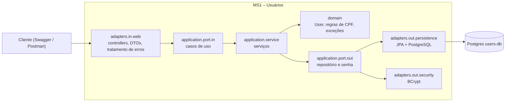

# Desafio Beca Java 2026

Sistema de gestão de finanças pessoais, desenvolvido para o Desafio Beca Java 2026. Aplica Java, APIs REST, persistência de dados, arquitetura hexagonal e microsserviços.

**Status:** em desenvolvimento. O MS1 (usuários) está pronto; o MS2 (transações) ainda será adicionado.

## Sumário

- [Arquitetura](#arquitetura)
- [Tecnologias](#tecnologias)
- [Estrutura do repositório](#estrutura-do-repositório)
- [Como subir o ambiente](#como-subir-o-ambiente)
- [Variáveis de ambiente](#variáveis-de-ambiente)
- [MS1 – Usuários](#ms1--usuários)
- [Importação de usuários por CSV](#importação-de-usuários-por-csv)
- [Testes e cobertura](#testes-e-cobertura)
- [Respostas e erros HTTP](#respostas-e-erros-http)

## Arquitetura

O sistema é composto por microsserviços independentes, cada um com seu próprio banco PostgreSQL:

| Serviço | Responsabilidade | Situação |
|---|---|---|
| **MS1 – Usuários** | Cadastro, consulta, atualização, exclusão e importação de usuários por CSV | Pronto |
| **MS2 – Transações** | Operações financeiras | A fazer |

O MS1 segue a **arquitetura hexagonal**: o domínio e os casos de uso não dependem de framework web nem de banco; quem fala com o mundo externo são os adaptadores, ligados por portas (interfaces).



Pacotes do MS1 (`users/src/main/java/br/com/beca/users`):

```
adapters/
  in/web/            UserController, DTOs, UserWebMapper, GlobalExceptionHandler, OpenApiConfig
  in/web/csv/        UserCsvController (upload do CSV)
  out/persistence/   UserPersistenceAdapter, entidade JPA, mapper, repositório
  out/security/      BCryptPasswordAdapter
application/
  port/in/           casos de uso (Create, List, FindById, Update, Delete, ImportUsersCsv)
  port/out/          UserRepositoryPort, PasswordEncoderPort
  service/           implementação dos casos de uso
domain/
  model/             User
  validation/        CpfValidator
  exception/         UserNotFoundException, UserAlreadyExistsException, InvalidCsvException
validation/          anotação @ValidCpf (Bean Validation)
```

## Tecnologias

Java 25, Maven, Spring Boot 4, Spring Data JPA, PostgreSQL 16, Bean Validation, Spring Security Crypto (BCrypt), Apache Commons CSV, Springdoc OpenAPI (Swagger), JUnit 5, Mockito, JaCoCo, Docker e Docker Compose, Git e GitHub.

## Estrutura do repositório

Monorepo, com um diretório por microsserviço:

```
desafio-beca-java-2026/
├── users/                 MS1 – Usuários
│   ├── src/
│   ├── exemplos/          CSV de exemplo para importação
│   ├── Dockerfile
│   └── pom.xml
├── docker-compose.yml
├── .env.example
├── users-api.http         requisições de exemplo (IntelliJ HTTP Client)
└── README.md
```

## Como subir o ambiente

**Pré-requisitos:** Java 25, Docker com Docker Compose (por exemplo, Rancher Desktop) e Git.

```bash
git clone https://github.com/gabsbackess/desafio-beca-java-2026.git
cd desafio-beca-java-2026
cp .env.example .env        # no Prompt de Comando: copy .env.example .env
```

Edite o `.env` e troque `seu_usuario` e `sua_senha` por valores locais.

> O `.env` contém credenciais locais. **Nunca** o envie ao GitHub (ele já está no `.gitignore`). O `.env.example` traz só os nomes das variáveis.

Suba tudo com um comando, na raiz do repositório:

```bash
docker compose up -d --build
```

O Compose sobe os bancos e o MS1. O MS1 só inicia depois que o banco do MS1 está saudável (`healthcheck`). Outros comandos úteis:

```bash
docker compose ps                  # situação dos containers
docker compose logs -f users       # logs do MS1
docker compose down                # parar (os dados ficam nos volumes)
docker compose down -v             # parar e apagar os dados
```

| Serviço | Porta local |
|---|---|
| MS1 – Usuários | 8081 |
| PostgreSQL – users-db | 5433 |
| PostgreSQL – transactions-db | 5434 |

## Variáveis de ambiente

Definidas no `.env` (modelo em `.env.example`):

| Variável | Para que serve |
|---|---|
| `USER_DB_NAME` | Nome do banco do MS1 |
| `USER_DB_USER` | Usuário do banco do MS1 |
| `USER_DB_PASSWORD` | Senha do banco do MS1 |
| `TRANSACTIONS_DB_NAME` | Nome do banco do MS2 |
| `TRANSACTIONS_DB_USER` | Usuário do banco do MS2 |
| `TRANSACTIONS_DB_PASSWORD` | Senha do banco do MS2 |

Dentro do Compose, o MS1 recebe a URL, o usuário e a senha do banco por variáveis `SPRING_DATASOURCE_*`. Rodando fora do Docker (IDE ou `./mvnw`), o `application.properties` usa `localhost:5433` e lê as variáveis acima do ambiente.

## MS1 – Usuários

URL base: `http://localhost:8081`

**Swagger (OpenAPI):** `http://localhost:8081/swagger-ui.html` — documenta todos os endpoints, com exemplos de requisição e resposta, e permite testá-los pelo navegador.

| Método | Rota | Descrição | Sucesso |
|---|---|---|---|
| POST | `/users` | Cadastrar usuário | 201 |
| GET | `/users` | Listar usuários | 200 |
| GET | `/users/{id}` | Buscar usuário pelo id | 200 |
| PUT | `/users/{id}` | Atualizar usuário | 200 |
| DELETE | `/users/{id}` | Excluir usuário | 204 |
| POST | `/users/import` | Importar usuários por CSV | 200 |

**Regras de negócio**

- **CPF:** os dígitos verificadores são conferidos e CPFs com todos os dígitos iguais são recusados. Aceita ponto e traço (`529.982.247-25`); é salvo só com dígitos. É único.
- **E-mail:** salvo sem espaços nas pontas e em minúsculas. É único.
- **Senha:** criptografada com BCrypt, até 72 caracteres, e **nunca** aparece nas respostas nem nos logs. No `PUT`, a senha é opcional e só muda quando vem preenchida.
- **Tamanhos:** nome até 100 caracteres e e-mail até 254.
- CPF ou e-mail já cadastrado responde 409.

Exemplo de cadastro:

```http
POST /users
Content-Type: application/json

{
  "name": "Maria Silva",
  "email": "maria.silva@example.com",
  "cpf": "529.982.247-25",
  "password": "Senha@123"
}
```

Resposta (201):

```json
{
  "id": 1,
  "name": "Maria Silva",
  "email": "maria.silva@example.com",
  "cpf": "52998224725",
  "createdAt": "2026-11-10T14:30:00"
}
```

## Importação de usuários por CSV

`POST /users/import`, com `multipart/form-data` e o arquivo no campo `file`. O exemplo `users/exemplos/usuarios-exemplo.csv` pode ser enviado direto pelo Swagger.

**Layout do arquivo**

- Separador: vírgula. Codificação: UTF-8 (o BOM do Excel é aceito).
- Cabeçalho obrigatório com as colunas `name`, `email`, `cpf` e `password`, em qualquer ordem e sem diferenciar maiúsculas.

```csv
name,email,cpf,password
Maria Silva,maria.silva@example.com,52998224725,Senha@123
Joao Santos,joao.santos@example.com,11144477735,Senha@456
Ana Oliveira,ana.oliveira@example.com,39053344705,Senha@789
```

**Regras**

- Máximo de 1.000 registros e 5 MB por arquivo.
- Cada linha passa pelas mesmas validações do cadastro (inclusive o CPF).
- Linha inválida ou duplicada (e-mail ou CPF repetido) **não interrompe** a importação: ela é listada no resultado, com o número da linha e o motivo.
- O arquivo inteiro é recusado (400) quando está vazio, tem cabeçalho inválido (inclusive coluna vazia), está malformado (por exemplo, aspas não fechadas) ou passa de 1.000 registros. Acima de 5 MB, responde 413.

**Resposta (200)**

```json
{
  "totalLines": 3,
  "registeredUsers": 2,
  "usersError": 1,
  "error": [
    "Linha 3: email: E-mail inválido."
  ]
}
```

## Testes e cobertura

Os testes usam JUnit 5 e Mockito (casos de uso, validação, controllers e adaptador de persistência). Não precisam do Docker nem do banco.

Rode dentro da pasta `users`:

```bash
./mvnw test        # no Prompt de Comando do Windows: mvnw.cmd test
./mvnw verify      # roda os testes e gera o relatório de cobertura
```

O relatório de cobertura (JaCoCo) fica em `users/target/site/jacoco/index.html`.

## Respostas e erros HTTP

| Código | Quando |
|---|---|
| 200 OK | Operação realizada |
| 201 Created | Usuário cadastrado |
| 204 No Content | Usuário excluído |
| 400 Bad Request | Dados inválidos, JSON quebrado, id inválido, CSV inválido |
| 404 Not Found | Usuário ou rota não encontrados |
| 405 / 415 | Método HTTP ou tipo de conteúdo não suportado |
| 409 Conflict | CPF ou e-mail já cadastrado |
| 413 Payload Too Large | Arquivo CSV acima de 5 MB |
| 500 Internal Server Error | Erro inesperado (mensagem fixa; o detalhe fica no log) |

Formato dos erros:

```json
{ "status": 404, "message": "Usuário não encontrado." }
```

Erros de validação listam todos os campos com problema:

```json
{
  "status": 400,
  "errors": {
    "email": "Necessário informar endereço de e-mail válido.",
    "cpf": "CPF inválido."
  }
}
```
